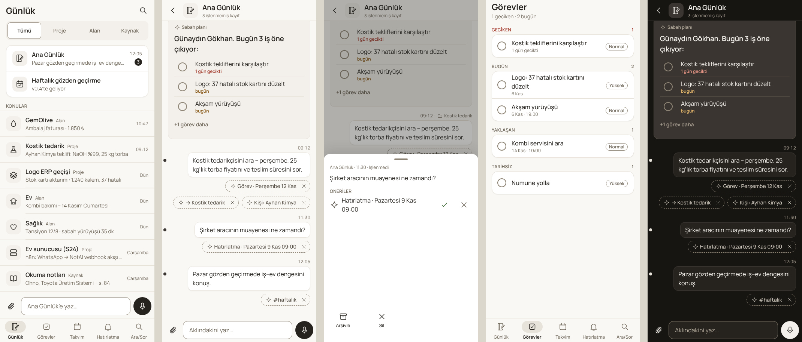

# NotAI

Gün içinde düşünmeden not/iş/fikir yakala; yapay zekâ seni tanıyarak sınıflandırsın, zamanı
gelince hatırlatsın. Kurgu WhatsApp gibi: ana ekranda **Ana Günlük** ve konular, akışta en yeni
kayıt en altta, altta sabit yazma çubuğu, kaydın altında AI öneri çipleri.

- Ürün kuralları: [`CLAUDE.md`](CLAUDE.md)
- Tasarım: [`design/`](design/) — brief, karar, token'lar, kılavuz, bileşenler, 14 ekran
- İşlev planı: [`docs/FEATURE_PLAN.md`](docs/FEATURE_PLAN.md) · Durum: [`docs/PROGRESS.md`](docs/PROGRESS.md)
- Mimari: [`docs/ARCHITECTURE.md`](docs/ARCHITECTURE.md)



## Kod düzeni (Cargo workspace, tamamı Rust)

| Crate | Ne yapar |
|---|---|
| `crates/core` | Alan modeli ve kurallar (kayıt durum makinesi, PARA konuları, görev/tekrar/hatırlatma, AI önerisi → etki, günlük zaman çizelgesi, sabah planı, senkron birleştirme). I/O yok. |
| `crates/store` | SQLite + sqlx (derleme zamanı denetimli sorgular). Her yazma transaction'da ve değişiklik günlüğünde; silme = çöp kutusu. |
| `crates/ai` | Sağlayıcıdan bağımsız LLM istemcisi (Claude API, yerel Gemma/Ollama), Türkçe istem, katı JSON şema doğrulaması. |
| `crates/sync` | Telefon ↔ masaüstü ↔ ev sunucusu senkronu (son yazan kazanır + alan kuralları). |
| `crates/server` | Ev sunucusu (axum): REST, AI işçisi, ses → yazı (Whisper), sabah planı zamanlayıcısı. |
| `crates/api` | Sunucu, uygulama ve arayüzün paylaştığı JSON tipleri. |
| `crates/tokens` | `design/tokens.json` → CSS üreticisi. |
| `crates/ui` | Leptos arayüzü (Rust → WASM). Tasarım dosyalarını derlerken gömer. |
| `crates/app` | Tauri 2 uygulama kabuğu (Android + Windows/Linux), yerel SQLite. |
| `crates/cli` | `notai` komut satırı aracı: ajanlar (Hermes / Claude Code) için iş al/cevapla, yakala, gelen kutusu. |

## Geliştirme

```bash
rustup target add wasm32-unknown-unknown
cargo install trunk sqlx-cli --locked      # bir kez
./scripts/check.sh                         # fmt + clippy -D warnings + tüm testler ("iş bitti" ölçütü)
```

- Şema ya da bir `sqlx::query!` değişirse: `./scripts/prepare-sqlx.sh` (`.sqlx/` önbelleğini günceller; commit edin).
- `design/tokens.json` değişirse: `cargo run -p notai-tokens --bin gen-tokens` (`design/tokens.css`'i üretir).
- Arayüzü tarayıcıda görmek için: `cd crates/ui && trunk serve` → http://localhost:8080 (Tauri dışında demo verisiyle açılır).
  Gerçek sunucuya bağlamak için: sunucuyu `NOTAI_CORS_ORIGINS=http://localhost:8080` ile başlat, sonra
  http://localhost:8080/?api=http://127.0.0.1:8787&token=<belirteç> adresini aç.
- Manrope yazı tipi (OFL) `crates/ui/fonts/` altında uygulamayla gelir; internete gidilmez.
- Linux masaüstü için Tauri kütüphaneleri: `libwebkit2gtk-4.1-dev libgtk-3-dev libsoup-3.0-dev librsvg2-dev`.

## Ev sunucusu (S24 Ultra)

```bash
cargo build --release -p notai-server
NOTAI_BIND=0.0.0.0:8787 \
NOTAI_DATABASE_URL=sqlite://notai.db \
NOTAI_API_TOKEN=uzun-rastgele-bir-değer \
NOTAI_AI=local NOTAI_AI_MODEL=gemma3:12b \
NOTAI_NTFY_URL=http://127.0.0.1:8080/notai \
./target/release/notai-server
```

| Değişken | Varsayılan | Açıklama |
|---|---|---|
| `NOTAI_BIND` | `127.0.0.1:8787` | Dinlenecek adres. Tailscale IP'sine bağlamak en güvenlisi. |
| `NOTAI_DATABASE_URL` | `sqlite://notai.db` | Veritabanı dosyası. |
| `NOTAI_API_TOKEN` | — | Uygulamanın `Authorization: Bearer` belirteci. Boşsa API açık kalır (yalnız güvenli ağda). |
| `NOTAI_AI` | `none` | `none` · `external` (S24'teki Hermes/Claude Code `notai` CLI ile sınıflandırır — `docs/AGENT.md`) · `local` (Ollama/Gemma) · `anthropic` (`ANTHROPIC_API_KEY` gerekir). |
| `NOTAI_AI_MODEL`, `NOTAI_AI_BASE_URL` | — / `http://127.0.0.1:11434` | Yerel model adı ve adresi; `anthropic` için varsayılan model `claude-opus-5-5`. |
| `NOTAI_MORNING_AT`, `NOTAI_TZ` | `09:00`, `Europe/Istanbul` | Sabah planı saati ve saat dilimi. |
| `NOTAI_NTFY_URL` | — | Sabah planı ve hatırlatmaları telefona bildirim olarak yollamak için ntfy konusu. |
| `NOTAI_STT_MODEL`, `NOTAI_STT_BASE_URL` | — / `http://127.0.0.1:8000` | Ses → yazı: Whisper (S24'te whisper.cpp; kurulum `docs/SES.md`). Telefon anında yazar, sunucu düzeltir. Boşsa sesler kuyrukta bekler, Whisper açılınca işlenir. |
| `NOTAI_VAULT_DIR` | — | Obsidian kasası klasörü. Ayarlıysa sunucu `NotAI/` alt klasörünü her değişiklikte günceller (konular iç içe klasörler, `Ana Günlük/` günlük notları, görevler Tasks biçiminde). Kendi notlarına dokunulmaz. Anında yazmak için `POST /api/vault/export`. |
| `NOTAI_CORS_ORIGINS` | — | Arayüzü tarayıcıda başka bir adresten açıp sunucuya doğrudan bağlanmak için izinli kökenler, virgülle (ör. `http://localhost:8080`). Boşsa kapalı; belirteç yine zorunludur. Uygulama kabuğu ve `notai` aracı için gerekmez. |
| `NOTAI_EMBED_MODEL`, `NOTAI_EMBED_BASE_URL` | — / `http://127.0.0.1:11434` | Ara/Sor anlamsal arama: OpenAI uyumlu embeddings (ör. Ollama `bge-m3`). Boşsa yalnız tam metin arama. |

AI kapalıyken her şey çalışır; kayıtlar yalnız "işlenmemiş" kalır. Otonom mod (yüksek güvenli
önerileri kendiliğinden uygulama, geri alınabilir) uygulamada Ayarlar → AI bölümünden açılır.

NotAI WhatsApp'tan kayıt yakalamaz (karar: 2026-11-08); yakalama uygulamadan (yazı, ses, ek) ve `notai capture` ile.

## Uygulama

```bash
cargo install tauri-cli --version "^2" --locked
cd crates/app
cargo tauri build                 # masaüstü (deb/AppImage/msi)
cargo tauri android init          # bir kez: Android Studio SDK + NDK gerekir (adım adım: docs/ANDROID.md)
cargo tauri android build --apk   # Android
```

Uygulama ilk açılışta tamamen yereldir: kayıt, konu, görev, hatırlatma (yerel bildirim), takvim,
haftalık gözden geçirme, ekler ve tam metin arama internetsiz çalışır. Ayarlar → Ev sunucusu bölümüne
adres ve belirteç girildiğinde dakikada bir senkronlanır; AI sınıflandırma, Ara/Sor cevabı ve sesli
yakalama ev sunucusunda çalışır.
